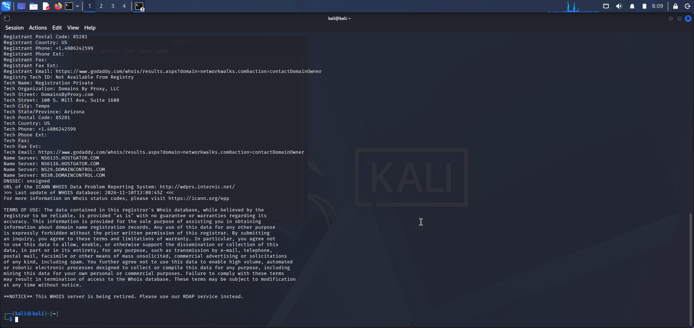
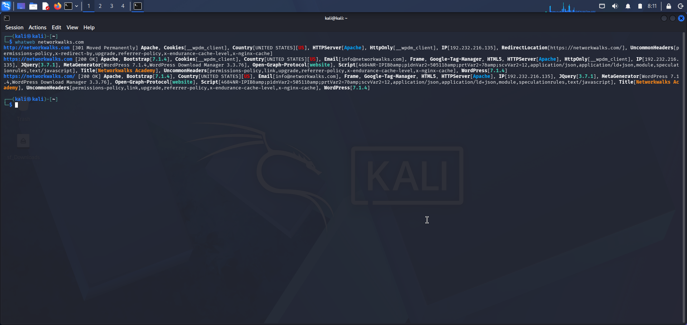
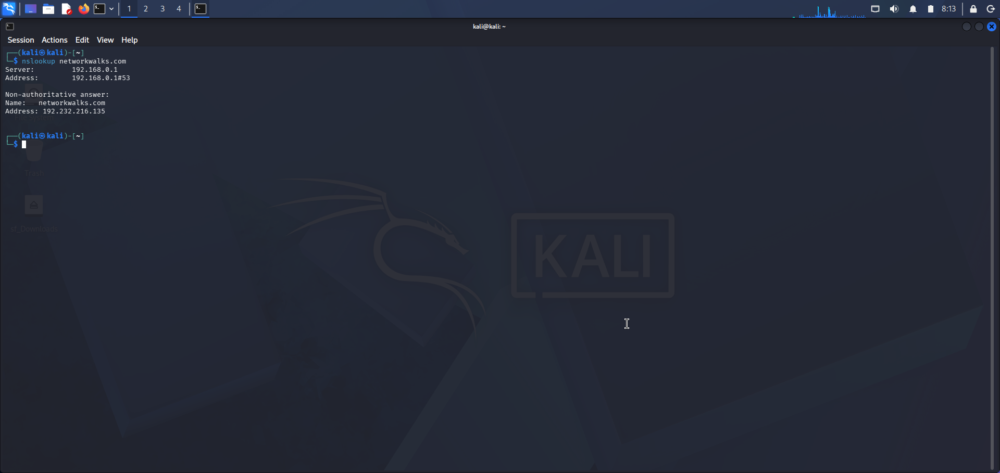
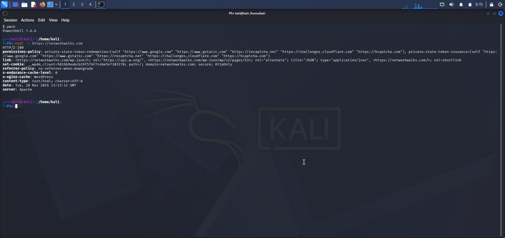
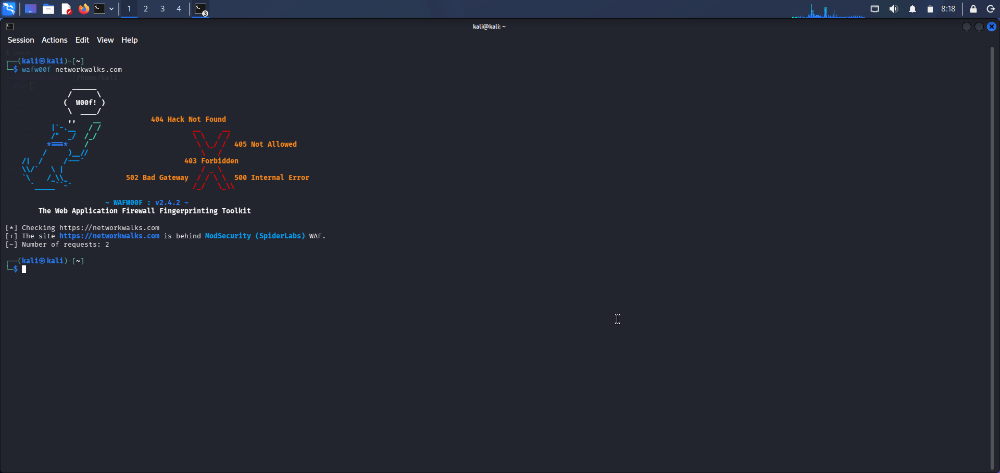
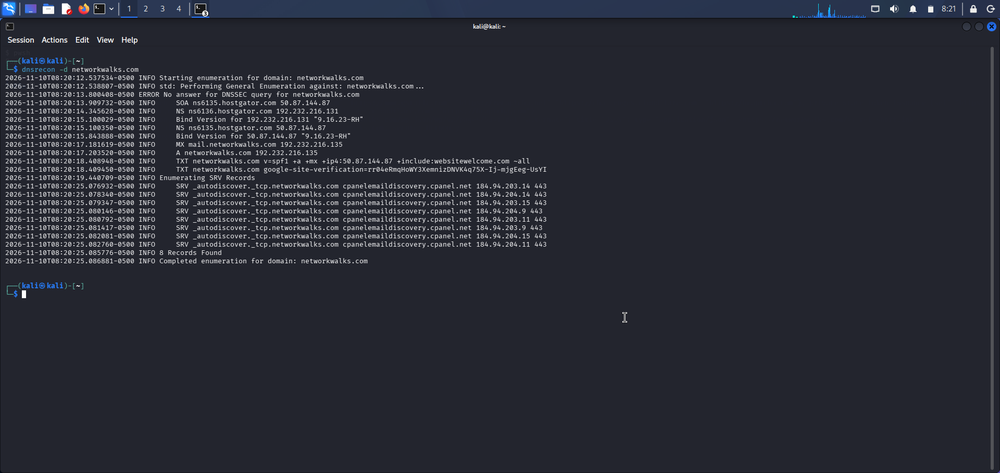

# PENETRATION TESTING REPORT 
### Footprinting & Network Scanning Phases

**W2-PM-FINAL  |  CYBERSECURITY  |  NETWORKWALKS**

| Field | Detail |
|---|---|
| **Pentester Name (Cybersecurity Professional)** | **ZULFA MAHMOUD IDD** |
| **Program/Batch** | B082-Networkwalks |
| **Date** | 12 November 2026 |
| **Modules completed** | 	W2-PM1 – Footprinting with Multiple Kali Tools; W2-PM4 – Footprinting & Reconnaissance with theHarvester; W2-PM5 – Zenmap Scanning |
| **Client/Target** | 1. Microsoft.com (Passive OSINT reconnaissance); 2. My Own Local LAN Network |
| **Permission secured from client?** | Yes |
| **Phases covered** | Phase 1: Reconnaissance & Footprinting; Phase 2: Scanning & Network Discovery; Phases 3–5: In Progress|

# 1. Liability Disclaimer

I have performed these activities only on the systems & devices where I had secured written permission or the devices/systems that I own myself. All these materials are for education and research purpose only. Do not use anything from here to break the law. The instructor, the authors and Networkwalks are not responsible for what you do with this knowledge. Every action you take is your own responsibility. Misuse can lead to criminal charges, heavy fines, loss of your job and a permanent record. In most countries unauthorised access is a crime even when nothing is damaged.

# 2. Introduction

This report presents the practical cybersecurity activities I completed during Week 2 of my internship program at Networkwalks. It focuses on Footprinting with Multiple Kali Linux Tools (W2-PM1), Footprinting and Reconnaissance Attacks with theHarvester (W2-PM4), and Network Scanning using Zenmap (W2-PM5).

The activities were conducted to develop practical skills in information gathering, footprinting, reconnaissance, network discovery, and identifying active hosts within a local network environment.

For the footprinting and reconnaissance exercises, I used Kali Linux and various tools to collect and analyze publicly available information about the assigned target. For the network scanning exercise, I used Zenmap to scan my own local network and identify active hosts and network details.

This report documents the procedures followed, commands and tools used, observations, findings, and supporting screenshots as evidence of the completed practical tasks. It also highlights the importance of reconnaissance and scanning in understanding potential security risks and strengthening cybersecurity awareness.

All activities were performed for educational purposes within the scope of the internship exercises.


# 3. Tools Used

The following tools were used to perform the Week 2 cybersecurity practical exercises:

| Tool | Purpose |
|---|---|
| Kali Linux | Operating system used for footprinting and reconnaissance activities. |
| theHarvester | Used to gather publicly available email addresses, subdomains, and related information about the target domain. |
| Nmap | Used for network discovery and scanning activities. |
| Zenmap | Graphical interface for Nmap, used to scan and visualize hosts on my local network. |
| WHOIS | Used to retrieve publicly available domain registration information. |
| DNS Tools | Used to gather and examine DNS records and domain-related information. |
| Terminal | Used to execute commands and interact with cybersecurity tools. |
| Windows 10 | Main operating system used for the lab environment and Zenmap scanning activities. |
| VirtualBox | Used to run the Kali Linux virtual machine. |

These tools helped me perform information gathering, domain reconnaissance, and local network discovery during the practical exercises.

# 4. Activities Performed

## 4.1 Footprinting & Reconnaissance Using Multiple Kali Linux Tools (W2-PM1)

I performed footprinting and reconnaissance activities against the `networkwalks.com` domain using six different tools available in Kali Linux: **WHOIS, WhatWeb, Nslookup, Curl, Wafw00f, and DNSRecon**.

Each tool was used to collect and examine a specific category of publicly available information about the target domain.

### 4.1.1 WHOIS

I used WHOIS to retrieve publicly available domain registration information, including registrar details, registration dates, and name server information.

The results helped me understand how domain ownership and registration information can be investigated during the reconnaissance phase.

### 4.1.2 WhatWeb

I used WhatWeb to identify the technologies and web application components used by the target website.

The scan identified WordPress 7.0.4 and WP Download Manager 3.3.58, together with other publicly exposed technology information.

### 4.1.3 Nslookup

I used Nslookup to perform DNS resolution and identify the IP address associated with the target domain.

The result returned the IP address `192.232.216.135`.

### 4.1.4 Curl

I used Curl with the `-I` option to inspect the HTTP response headers returned by the target website.

The results provided information about the web server response and exposed the WordPress REST API endpoint `/wp-json/`.

### 4.1.5 Wafw00f

I used Wafw00f to check whether a Web Application Firewall (WAF) was protecting the target website.

The result identified ModSecurity (SpiderLabs) as the detected Web Application Firewall.

### 4.1.6 DNSRecon

I used DNSRecon to perform DNS enumeration and gather information about the target domain's DNS infrastructure.

The results included information relating to name servers, mail servers, SPF/TXT records, service records, and DNS software information.

Screenshots showing the commands executed and their corresponding outputs are included as evidence of the completed practical exercise.

## 4.2 Footprinting & Reconnaissance Attacks Using theHarvester (W2-PM4)

I performed footprinting and reconnaissance activities using theHarvester tool in Kali Linux to identify publicly available email addresses, subdomains, and host information associated with the target organization, `microsoft.com`.

The practical exercise consisted of two tasks using different data source configurations to compare the information obtained from public sources.

### 4.2.1 Task 1: Information Gathering Using Baidu

For the first task, I used theHarvester with Baidu as the selected data source and configured the result limit to 1,000.

The following command was executed in the Kali Linux terminal:

```bash
theHarvester -d microsoft.com -l 1000 -b baidu
```

**Command explanation:**
- `-d`: Specifies the target domain.
- `microsoft.com`: The organization domain being investigated.
- `-l 1000`: Sets the maximum number of results to 1,000.
- `-b baidu`: Specifies Baidu as the information source.

After executing the command, I examined the output to identify the email addresses, subdomains, and host information returned by the tool.

A screenshot of the command execution and its output is included as supporting evidence.

### 4.2.2 Task 2: Information Gathering Using All Supported Sources

For the second task, I repeated the reconnaissance exercise using all sources supported by theHarvester. The result limit was configured to 50.

The following command was executed:

```bash
theHarvester -d microsoft.com -l 50 -b all
```

**Command explanation:**
- `-d`: Specifies the target domain.
- `microsoft.com`: The organization domain being investigated.
- `-l 50`: Sets the maximum number of results to 50.
- `-b all`: Requests information from all supported sources.

After running the command, I reviewed the output and examined the information collected from the available public sources.

A screenshot of the execution and resulting output is included as evidence of the completed task.

### 4.2.3 Observations and Learning Outcomes

Through these two exercises, I learned how theHarvester can be used to collect publicly available information from different sources during passive reconnaissance.

I also observed that different data sources may return different results depending on their available information and search capabilities.

The exercise demonstrated the importance of identifying publicly exposed email addresses, subdomains, and hosts when assessing an organization's external information exposure.

Both tasks were completed successfully as part of the Week 2 practical training activities.

# 5. Risk Analysis / Impact

Based on the information collected during the footprinting, reconnaissance, and network scanning activities, I identified several potential information exposure risks that could be relevant to an organization's security posture.

The following table summarizes the observations, supporting evidence, potential impacts, and estimated risk levels.

| # | Risk / Finding | Evidence / Observation | Potential Impact | Risk Level |
|---|---|---|---|---|
| 1 | Web technology information exposed | WhatWeb identified WordPress and WP Download Manager. | Attackers may use exposed technology information to identify potential weaknesses and outdated components. | Medium |
| 2 | Server IP address identifiable | Nslookup resolved the target domain to an IP address. | Provides information that may assist further infrastructure reconnaissance. | Low |
| 3 | HTTP technical information exposed | Curl returned HTTP response headers and exposed the `/wp-json/` endpoint. | May assist attackers in identifying web technologies and conducting further enumeration. | Low |
| 4 | WAF technology identifiable | Wafw00f identified ModSecurity (SpiderLabs). | Reveals information about the website's security infrastructure. | Low |
| 5 | DNS infrastructure information exposed | DNSRecon identified name servers, mail servers, SPF/TXT records, and service-related records. | May help attackers develop a broader understanding of the organization's infrastructure. | Medium |
| 6 | Public email addresses and subdomains discoverable | theHarvester collected publicly available information using Baidu and other supported sources. | Exposed email addresses may be targeted in phishing campaigns, while discovered subdomains may reveal additional internet-facing assets. | Medium |
| 7 | Multiple live hosts discovered on local network | Zenmap identified active hosts during the local network scanning exercise. | Unidentified or unauthorized devices could introduce potential security risks if not properly monitored. | Medium |

### Risk Level Classification

- **Critical:** A severe security issue that could result in significant damage.
- **High:** A serious potential security weakness requiring urgent attention.
- **Medium:** A potential security concern that requires further investigation and appropriate controls.
- **Low:** Limited information exposure that should be monitored and reviewed.

### Overall Risk Assessment

The findings from these practical exercises demonstrate how publicly available information and network discovery can provide useful intelligence during the early stages of penetration testing.

Information such as domain registration details, website technologies, IP addresses, DNS records, email addresses, subdomains, and active network hosts may help an attacker understand an organization's digital environment.

However, these observations do not automatically represent confirmed security vulnerabilities. The exercises primarily focused on passive reconnaissance, footprinting, and network scanning. No exploitation or vulnerability validation was conducted as part of these activities.

Further authorized security assessments would be necessary to determine whether any identified information exposure could lead to an actual security vulnerability.

# 6. Recommendations and Mitigation Measures

Based on the observations and potential risks identified during the footprinting, reconnaissance, and network scanning activities, I recommend the following security improvements:

1. **Review Publicly Exposed Technology Information**

   Organizations should regularly assess publicly available information about their websites, content management systems (CMS), plugins, and web technologies to minimize unnecessary information exposure.

2. **Keep Software and Applications Updated**

   CMS platforms, plugins, web applications, and other software components should be regularly updated to address known security weaknesses and reduce potential attack opportunities.

3. **Review HTTP Response Headers**

   Organizations should review their HTTP response headers and configure them appropriately to minimize unnecessary disclosure of server and application details.

4. **Regularly Review DNS Records**

   DNS records should be periodically reviewed to ensure that only necessary information and services are publicly accessible. Unused or outdated records should be removed.

5. **Properly Configure and Monitor the Web Application Firewall**

   Organizations should ensure that their Web Application Firewall (WAF), such as ModSecurity, is properly configured, regularly updated, and monitored to help detect and block malicious web traffic.

6. **Monitor Publicly Exposed Email Addresses and Subdomains**

   Organizations should review publicly discoverable email addresses and subdomains to identify unnecessary information exposure and implement appropriate protections against phishing and unauthorized access.

7. **Perform Regular Internal Network Discovery**

   Organizations should periodically conduct authorized network scans to identify active devices and maintain visibility of connected systems.

8. **Investigate Unknown or Unauthorized Devices**

   Any unexpected devices discovered during network scanning should be investigated to confirm whether they are authorized to access the network.

9. **Maintain Updated Network Documentation**

   Network topology, IP address assignments, connected devices, and network infrastructure information should be documented and updated regularly.

10. **Conduct Regular Authorized Security Assessments**

    Organizations should perform periodic security assessments, vulnerability scans, and penetration testing within an approved scope to identify and address potential security weaknesses.

11. **Ensure Proper Authorization for Security Testing**

    All reconnaissance, scanning, and other security testing activities should be conducted only against systems and networks for which appropriate authorization has been obtained.


# 7. Conclusion

The Week 2 practical exercises provided me with valuable hands-on experience in footprinting, reconnaissance, and network scanning as part of my cybersecurity internship at Networkwalks.

Through W2-PM1, I gained practical experience using multiple Kali Linux tools, including WHOIS, WhatWeb, Nslookup, Curl, Wafw00f, and DNSRecon, to collect and analyze publicly available information about a target domain.

Through W2-PM4, I learned how to use theHarvester with different data sources, including Baidu and all supported sources, to discover publicly available email addresses, subdomains, and host information associated with a target organization.

Through W2-PM5, I gained practical experience using Zenmap to perform local network scanning, identify active hosts, and understand network discovery and visualization.

Overall, these activities improved my understanding of the reconnaissance and scanning phases of penetration testing. They also helped me develop practical skills in using cybersecurity tools, interpreting technical results, and documenting findings.

This practical experience has strengthened my foundation in ethical hacking and cybersecurity assessment. It has also prepared me for further learning and more advanced penetration testing activities in the remaining phases of the internship.

All exercises were conducted for educational purposes within the scope of the assigned practical tasks.
# 8. Evidences Collected

*Screenshots collected as evidence during the activities :*














# 9. References

The following resources were used as references and learning materials during the Week 2 cybersecurity practical exercises:

1. **Networkwalks.** (2026). *Week 2 – Project Module 1: Footprinting with Multiple Kali Linux Tools.* Networkwalks Cybersecurity Internship Training Materials.

2. **Networkwalks.** (2026). *Week 2 – Project Module 4: Footprinting & Reconnaissance Attacks with theHarvester.* Networkwalks Cybersecurity Internship Training Materials.

3. **Networkwalks.** (2026). *Week 2 – Project Module 5: Network Scanning with Zenmap.* Networkwalks Cybersecurity Internship Training Materials.

4. **theHarvester Documentation.** GitHub Repository. https://github.com/laramies/theHarvester

5. **Nmap Documentation.** Official Nmap Reference Guide. https://nmap.org/book/man.html

6. **Kali Linux Documentation.** Official Kali Linux Documentation. https://www.kali.org/docs/

7. **OWASP Foundation.** Web Security Testing and Information Gathering Resources. https://owasp.org/

These references supported the practical exercises and helped me understand the tools, commands, and techniques used during the footprinting, reconnaissance, and network scanning activities.


-End-

 Author
ZULFA MAHMOUD IDD
Cybersecurity Professional B082
LinkedIn: https://www.linkedin.com/in/zulfa-mahmoud?utm_source=share_via&utm_content=profile&utm_medium=member_ios

📌 Project Information
Program Name: Cybersecurity program at Networkwalks | Week: 02 | Repository: GitHub


